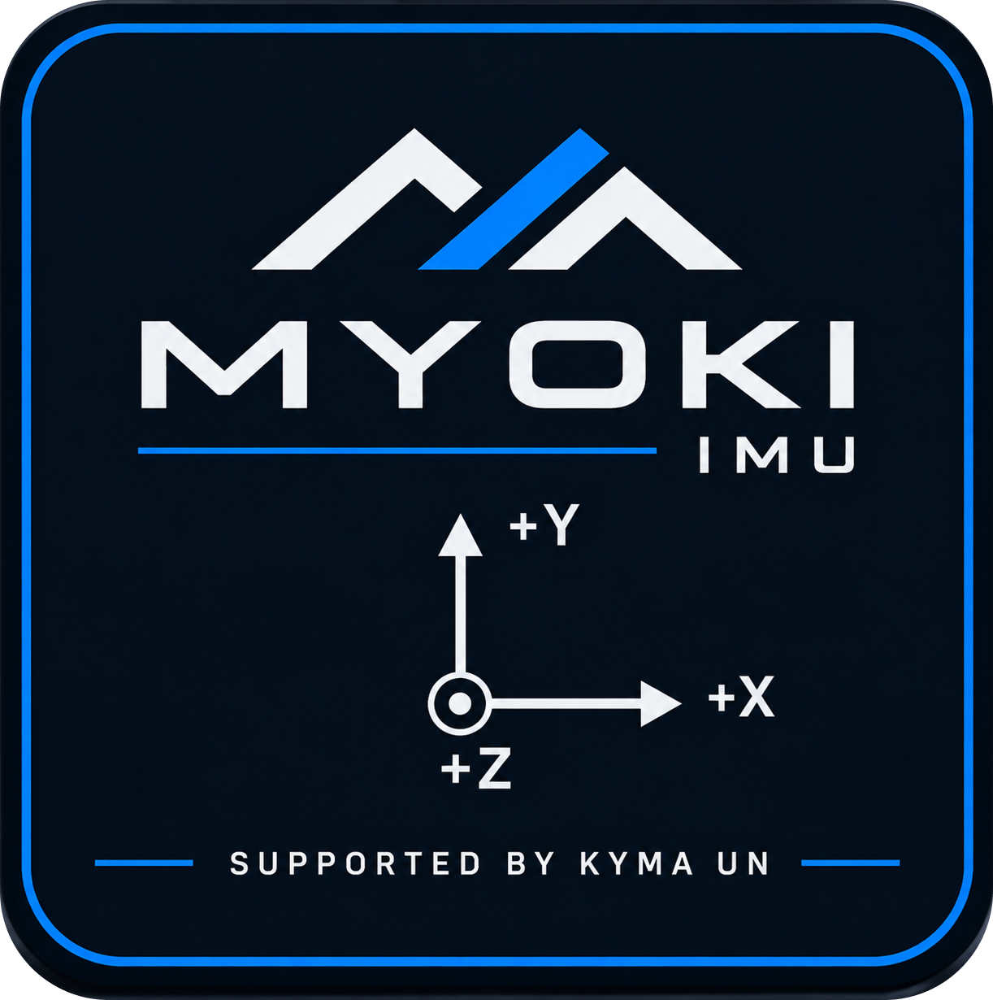

<div align="center">


<br>
<br>

**Make Your Own Kalman Implementation**

Tarjeta IMU modular y de código abierto para aprender filtros de Kalman en la asignatura de **Sensores y Actuadores**.
Basada en MYOSA del IEEE Sensors Council.

<br>


</div>

## Qué es MYOKI

MYOKI es un *stack* de tres PCB cuadradas de 38.1 mm que se apilan con conectores hembra de 2.54 mm:

| Capa | Proyecto KiCad | Componente principal | Función |
| --- | --- | --- | --- |
| Base | [`myoki-mini-esp32-base`](hardware/myoki-mini-esp32-base) | ESP32-C3 SuperMini | MCU, alimentación (5 V / 3.3 V) y bus I²C / SPI |
| Capa IMU | [`myoki-bmi160-layer`](hardware/myoki-bmi160-layer) | GY-BMI160 | Acelerómetro + giróscopo de 6 ejes |
| Capa magnetómetro | [`myoki-gy271-layer`](hardware/myoki-gy271-layer) | GY-271 | Magnetómetro de 3 ejes |

El dibujo de ejes de la tapa marca la orientación del sistema de referencia de la placa (**+X**, **+Y** y **+Z** saliendo de la placa).

<div align="center">

</div>

## Estructura del repositorio

```text
myoki-board/
├── assets/                     Logos y arte gráfico
│   ├── myoki-design-top.png    Diseño de la tapa (acrílico)
│   ├── myoki-logo-banner.png   Banner para documentación
│   ├── myoki-logo-white.png    Logo transparente para fondos oscuros
│   └── myoki-logo-navy.png     Logo transparente para fondos claros
├── hardware/                   Fuentes de diseño (KiCad 10)
│   ├── lib/                    Librería propia "myoky-lib"
│   │   ├── myoky-lib.kicad_sym     Símbolos
│   │   ├── myoky-lib.pretty/       Footprints
│   │   ├── myoky-lib.3dshapes/     Modelos 3D (STEP)
│   │   └── vendor/                 Archivos originales de los fabricantes
│   ├── myoki-mini-esp32-base/  PCB base con ESP32-C3
│   ├── myoki-bmi160-layer/     PCB del BMI160
│   └── myoki-gy271-layer/      PCB del GY-271
└── manufacturing/              Todo lo necesario para fabricar
    ├── gerbers/                Gerbers + drill por placa y .zip listos para enviar
    └── enclosure/              Carcasa: STL para impresión 3D y DXF para corte láser
```

## Cómo construir una MYOKI

### 1. Fabricar las PCB

Sube cada `.zip` de [`manufacturing/gerbers/`](manufacturing/gerbers) a tu fabricante (JLCPCB, PCBWay, etc.):

| Archivo | Placa |
| --- | --- |
| [`myoki-mini-esp32-base.zip`](manufacturing/gerbers/myoki-mini-esp32-base.zip) | Base ESP32-C3 |
| [`myoki-bmi160-layer.zip`](manufacturing/gerbers/myoki-bmi160-layer.zip) | Capa BMI160 |
| [`myoki-gy271-layer.zip`](manufacturing/gerbers/myoki-gy271-layer.zip) | Capa GY-271 |

Parámetros: 2 capas, FR-4, 1.6 mm, 38.1 × 38.1 mm.

### 2. Comprar los componentes

| Cant. | Componente | Placa |
| --- | --- | --- |
| 1 | ESP32-C3 SuperMini | Base |
| 1 | Módulo GY-BMI160 | Capa BMI160 |
| 1 | Módulo GY-271 | Capa GY-271 |
| 3 | Condensador 100 nF, 1206 | Base |
| 1 | Resistencia 330 Ω, 1206 | Base |
| 1 | LED rojo, 2010 (5025 métrico) | Base |
| 6 | Conector hembra 1×04, 2.54 mm | 2 por placa |
| 4 | Separadores y tornillos M3 | Stack |

### 3. Fabricar la carcasa

| Archivo | Proceso |
| --- | --- |
| [`base_plastic_v03.stl`](manufacturing/enclosure/base_plastic_v03.stl) | Impresión 3D, base |
| [`plastic_case_top.stl`](manufacturing/enclosure/plastic_case_top.stl) | Impresión 3D, tapa |
| [`acrylic_drawing.dxf`](manufacturing/enclosure/acrylic_drawing.dxf) | Corte láser en acrílico, con el [diseño de la tapa](assets/myoki-design-top.png) |

### 4. Ensamblar

1. Suelda los componentes SMD y el ESP32-C3 en la base.
2. Suelda los módulos GY-BMI160 y GY-271 en sus capas.
3. Apila las placas con los conectores de 2.54 mm y fíjalas con los separadores M3.
4. Monta el stack en la carcasa y cierra con la tapa de acrílico.

## Editar el diseño

Abre cualquier `.kicad_pro` dentro de [`hardware/`](hardware) con **KiCad 10**. Cada proyecto incluye sus propias `fp-lib-table` y `sym-lib-table`, que apuntan a `${KIPRJMOD}/../lib`, así que la librería `myoky-lib` y sus modelos 3D se cargan sin configuración extra.

<div align="center">


<br>

<picture>
  <source media="(prefers-color-scheme: dark)" srcset="assets/myoki-logo-white.png">
  
</picture>

**S U P P O R T E D &nbsp; B Y &nbsp; K Y M A &nbsp; U N**

Licencia [MIT](LICENSE) © 2026 KYMA UN

</div>
